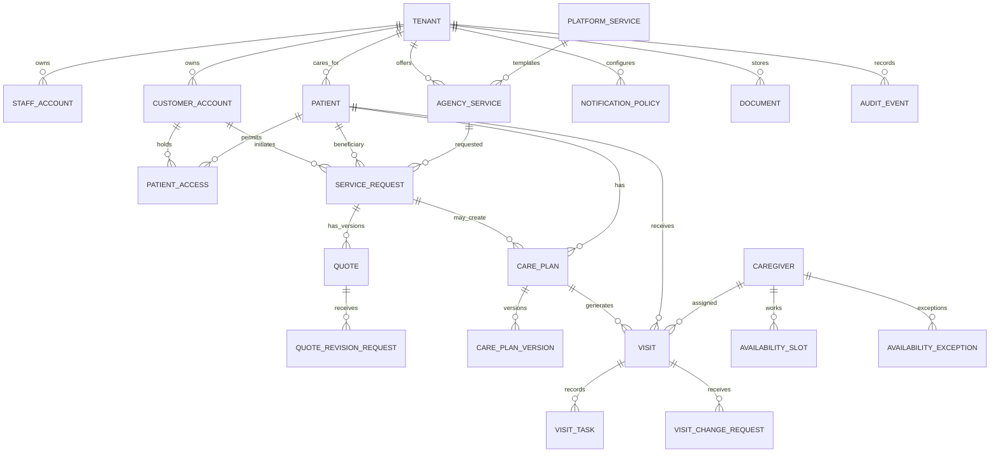

# 06 — Relational Data Model and Integrity Design

## General schema conventions
- PostgreSQL; Prisma migrations checked in. UUID IDs (`uuid`) for internal primary keys; separate public display codes (REQ-..., VIS-...) generated per tenant or non-sequential opaque IDs to avoid information leaks. IDs are never permission grants.
- Agency-owned tables include `tenant_id UUID NOT NULL`; child foreign keys use tenant-consistent composite constraints when practical (unique `(tenant_id,id)` on parent and composite FK referencing it), plus application checks.
- Standard `created_at`, `updated_at` (UTC), `created_by`, optional `archived_at`. Use soft archive for active business entities. Restrict cascading delete on audited records.
- Sensitive columns require controlled projections and appropriate encryption strategy; do not index free-text care notes for cross-tenant global search.
- Use JSONB only for immutable snapshots/config/options, not to avoid proper relations.

## ERD — logical core

Note: guest requests use `customerAccountId=NULL`, requester email persisted securely; visits can have `carePlanId=NULL` for one-offs; caregiver may be NULL before assignment. ERD omits platform operators, invitation, email jobs and join tables for legibility.

## Identity and tenancy tables
| Table | Essential fields | Constraints / notes |
|---|---|---|
| `tenants` | `id, slug, legalName, displayName, status(PENDING_APPROVAL,ACTIVE,SUSPENDED), timezone, currency, travelBufferMin, brandJson, supportEmail, areaConfigJson` | unique normalized slug; status changes audited; allowed currency and timezone validated |
| `platform_operators` | `id,email,passwordHash,mfaState,status` | separate identity scope; no tenant credentials |
| `staff_accounts` | `id,tenantId,emailNormalized,passwordHash,role,status,sessionVersion` | unique(tenantId,emailNormalized); role ACL; invitation-based |
| `customer_accounts` | `id,tenantId,emailNormalized,passwordHash,status,emailVerifiedAt,sessionVersion` | unique(tenantId,emailNormalized); no shared customer realm |
| `staff_invitations` | `id,tenantId,emailNormalized,role,tokenHash,expiresAt,consumedAt,createdBy` | hashed opaque token, single-use |
| `auth_sessions` | `id,principalType,principalId,tenantId?,secretHash,expiresAt,revokedAt,sessionVersion` | no raw token; index secretHash; platform sessions tenant NULL |
| `guest_action_tokens` | `id,tenantId,requestId,emailHash,tokenHash,purpose,expiresAt,consumedAt` | short TTL, only relevant scoped action |

## Catalog and requests
| Table | Essential fields | Constraints / notes |
|---|---|---|
| `platform_services` | `id,code,defaultNameAr,defaultNameEn,description,clinicalClass,defaultQualificationCodes,active` | canonical templates controlled by platform; never exposed if disabled |
| `agency_services` | `id,tenantId,templateId?,slug,nameAr,nameEn,summary,description,imageDocumentId?,durationMin,allowStandalone,allowRecurring,requiredQualificationCodes,serviceAreaIds,pricingType,priceMinor?,pricingUnit?,isEnabled,isPublished` | unique(tenantId,slug); custom service may have no template; validation for clinical service class |
| `service_requests` | `id,tenantId,agencyServiceId,customerAccountId?,patientId?,requesterName,requesterEmailNormalized,requesterPhone?,beneficiaryName,relationship,areaId,preferredWindowJson,notesRestricted?,status,priceAcknowledgementJson?,submittedAt,decisionAt?` | tenant-scoped; private notes; minimal guest data |
| `request_status_history` | `id,tenantId,requestId,fromStatus,toStatus,actorId,reason?,at` | append-only |
| `quotes` | `id,tenantId,requestId,quoteGroupId,version,status,currency,lineItemsSnapshot,totalMinor,termsSnapshot,validUntil,sentAt,acceptedAt?,acceptedByPrincipalId?` | unique(tenantId,quoteGroupId,version); immutable from SENT except state timestamps |
| `quote_revision_requests` | `id,tenantId,quoteGroupId,quoteId,customerAccountId?,requesterVerifiedTokenRef?,message,status,createdAt,resolvedAt?` | partial unique pending per quoteGroup |

## Patients and access
| Table | Essential fields | Constraints / notes |
|---|---|---|
| `patients` | `id,tenantId,displayName,dateOfBirth?,contact?,areaId,addressRestricted?,status,notesRestricted?` | same-tenant relationships; no automatic duplicate uniqueness by name |
| `patient_access` | `id,tenantId,patientId,customerAccountId,scopeFlags,authorizationType,verifiedBy?,verifiedAt?,expiresAt?,revokedAt?,status` | scoped grants; unique active grant per patient/customer association with appropriate DB partial constraint |
| `patient_duplicate_reviews` | `id,tenantId,newRequestId?,candidatePatientId,reviewedBy,decision(reason),createdAt` | record manual linking decision; no auto-merge |
| `documents` | `id,tenantId,parentType,parentId,storageKey,originalNameRestricted,mime,sizeBytes,checksum,scanStatus,classification,createdBy,archivedAt?` | private object store, no globally public URL; parent auth required |

## Caregivers and schedule
| Table | Essential fields | Constraints / notes |
|---|---|---|
| `caregivers` | `id,tenantId,staffAccountId?,name,professionalCategory,operationalStatus,serviceAreasJson,qualificationVerificationStatus` | unique(tenantId,staffAccountId) where not null; one tenant per account |
| `caregiver_qualifications` | `id,tenantId,caregiverId,code,licenseIssuer?,licenseNumberRestricted?,verifiedBy?,verifiedAt?,validThrough?,status,documentId?` | expiry checked at visit date; verification cannot be self-asserted as valid |
| `caregiver_service_authorizations` | `tenantId,caregiverId,agencyServiceId,authorizedAt,authorizedBy` | composite PK |
| `availability_slots` | `id,tenantId,caregiverId,weekday(0..6),localStartTime,localEndTime,effectiveFrom?,effectiveTo?` | start<end; no overlapping intervals for same caregiver/day/effective period unless intentionally supported |
| `availability_exceptions` | `id,tenantId,caregiverId,localDate,startLocal?,endLocal?,type(UNAVAILABLE,OVERRIDE_HOURS),reason,approvedBy` | effective coverage, conflict scan triggered |
| `care_plans` | `id,tenantId,patientId,serviceRequestId?,agencyServiceId,primaryCaregiverId?,status,currentVersion,startedAt?,closedAt?` | separate patient and service, unique? multiple possible |
| `care_plan_versions` | `id,tenantId,carePlanId,version,validFrom,validUntil,weekdaysJson,localStartTime,durationMin,goalText,taskTemplatesJson,clinicalInstructionsRestricted?,approvedByQualifiedStaffId?,approvedAt?,createdAt` | unique(tenantId,carePlanId,version); immutable after approval/activation; span <= 60 days at activation |
| `visits` | `id,tenantId,patientId,agencyServiceId,carePlanId?,planVersionId?,occurrenceKey?,assignedCaregiverId?,scheduledStartUtc,scheduledEndUtc,timezoneSnapshot,status,assignmentHealth,reviewStatus,actualStartAt?,actualEndAt?,version,customerConfirmedAt?` | tenant-checked FKs; unique(tenantId,carePlanId,occurrenceKey) for recurring (null excluded); enforce start<end, end>=start; optimistic `version` |
| `visit_tasks` | `id,tenantId,visitId,order,descriptionSnapshot,isRequired,outcome(PENDING,DONE,NOT_DONE),notDoneReason?,doneAt?,updatedBy?` | derived from effective plan/task; no silent overwrite on completion |
| `visit_notes` | `id,tenantId,visitId,authorId,bodyRestricted,isDraft,isAddendum,parentNoteId?,reason?,createdAt` | immutable after finalization; correction via append-only addendum |
| `visit_assignment_history` | `id,tenantId,visitId,oldCaregiverId?,newCaregiverId,changedBy,reason?,createdAt` | append-only |
| `visit_change_requests` | `id,tenantId,visitId,requesterAccountId?,verifiedGuestRequestId?,type,status,urgency,proposedStartUtc?,reason,policySnapshotJson,decisionBy?,decisionAt?` | pending unique per visit; keep original schedule until approval |

## Notifications and audit
| Table | Essential fields | Constraints / notes |
|---|---|---|
| `notification_policies` | `tenantId,eventType,channel,enabled,reminderOffsetMin?` | unique(tenantId,eventType,channel); protected rules cannot be disabled |
| `notifications` | `id,tenantId,principalType,recipientPrincipalId,eventType,entityType,entityId,safeTitle,safeSummary,readAt?,createdAt` | tenant-scoped, sparse content, no PHI in payload |
| `outbox_events` | `id,tenantId?,eventType,aggregateId,payloadMinimal,createdAt,processedAt?` | atomic with state transition; idempotent worker |
| `email_deliveries` | `id,tenantId,eventId,recipientHash,templateId,status,attempts,providerMessageId?,lastErrorCode?` | unique(eventId,recipientHash,templateId); no sensitive content in logs |
| `audit_events` | `id,tenantId?,actorId,actorType,action,entityType,entityId,metadataSafe,reason?,correlationId,createdAt` | append-only, paged restricted admin review |
| `idempotency_keys` | `id,tenantId,principalId?,key,requestHash,responseSummary,expiresAt` | unique(tenantId,principalId,key), store safe response ref not sensitive body |

## Required database invariants
1. Scoped composite FKs where possible, plus transaction-time same-tenant checks for polymorphic parents. Avoid unsafe `ON DELETE CASCADE` on audits and medical-operation records.
2. Functional unique index on `(tenant_id, lower(email))` if case-normalized column not used. Null emails absent only where registration not allowed.
3. Partial unique: one PENDING quote revision per `(tenant_id,quote_group_id)`; one PENDING visit change request per `(tenant_id,visit_id)`; one SENT effective quote per group.
4. Unique care plan version and occurrence key guarantee idempotent generation. `version` int on mutable visits for optimistic concurrency.
5. `CHECK scheduled_end_utc > scheduled_start_utc`; `CHECK actual_end_at IS NULL OR actual_start_at IS NOT NULL` and duration nonnegative; `CHECK price_minor >= 0`; expiry indexes.
6. Do not rely on a simple DB exclusion constraint for travel buffers that vary by tenant; serialize caregiver assignments in transactions as in architecture. Consider additional overlap-only exclusion where feasible as defense in depth, not replacement.
7. Indexes: `visits(tenant_id,assigned_caregiver_id,scheduled_start_utc,status)`, `visits(tenant_id,patient_id,scheduled_start_utc)`, `requests(tenant_id,status,submitted_at)`, `quotes(tenant_id,request_id,version)`, `patients(tenant_id,lower(display_name))`, `notifications(tenant_id,recipient_principal_id,read_at,created_at)`.
8. Retention and deletion policy for patient/medical data is jurisdiction-dependent; no blanket TTL or cascading erasure policy presumed safe.

## Explicit snapshots required
At request creation: published service name/pricing type/price acknowledgment and privacy notice version. At quote send: scope/units/currency/total/validity/terms. At plan activation: recurrence/clinical instruction version/task templates. At visit generation: display service name/task templates/schedule timezone. At change-request submission: cutoff policy and original scheduled time. At completion: task outcome and finalized notes.

## Migration strategy
Use additive migrations + backfills + constraints; never edit history of applied migrations. Seed platform services with stable codes; seed example agencies/patients **synthetic only**. Add composite integrity constraints with verified matching rows; test rollback of app deploy without rolling back irreversible data migrations.
