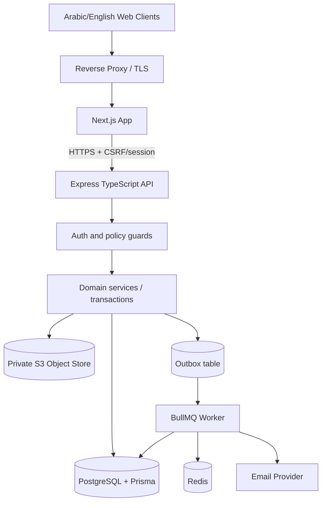

# 08 — Architecture, Infrastructure, Reliability

## Suggested deployment architecture


## Bounded modules
- `platform`: tenants status, approvals, usage aggregations.
- `identity`: platform vs agency staff vs customer sessions, invites, email verification, grants.
- `catalog`: platform templates, agency services, pricing, publishing.
- `requesting`: guest request, verification, lifecycle, patient association.
- `commercial`: quote versions, revisions, acceptance.
- `patients`: operational patient records, authorization, duplicate candidates, attachments.
- `caregivers`: qualifications, verified authorizations, weekly availability and exceptions.
- `care-plans`: versioned instructions, recurring templates and generation.
- `scheduling`: candidate query/ranking, conflict engine, direct assignment, change requests.
- `visits`: execution, tasks, completion, review and corrections.
- `notifications`: event/policies, in-app and email jobs.
- `reports`: tenant-local operational aggregates.
- `audit`: append-only events and reason tracking.

Use a **modular monolith** API initially: one deployable Express server with internal module boundaries, not premature microservices. Separate worker process only for asynchronous tasks.

### Implemented module shape (Sprint 5 architecture stabilization)

The care-plan and scheduling domains are decomposed behind stable interfaces
(ADR-0012; Stage 0-2 of the incremental architecture stabilization design):

- `care-plans` exposes one facade, `createCarePlanService(db, now)`, composed of
  `care-plan.queries.ts` (list/detail/preview reads), `care-plan-draft.service.ts`
  (create/edit/revise with linkage and one-open-draft enforcement),
  `care-plan-clinical-approval.service.ts` (exact-version approval),
  `care-plan-activation.service.ts` (idempotent occurrence generation) and
  `care-plan-lifecycle.service.ts` (pause/resume/complete/cancel). Scoped
  loaders/locks/projections live in `care-plan.repository.ts`; the single
  recurrence-content mapping lives in `care-plan-content.ts`. The facade is
  composition-only; controllers compose the facade, not internals.
- `care-plan-assignment-policy.ts` is the narrow scheduling-to-care-plans seam:
  `scheduling` imports only this public interface to lock and recheck parent-plan
  assignability at commit time. No reverse import exists.
- `scheduling` separates reads from commands: `visit.queries.ts` owns visit
  list/detail (authorization, tenant-local date windows, pagination, safe
  projections); `assignment.service.ts` owns only assign/reassign/bulk commands
  with their idempotency and lock protocol. The controller composes both.
  `bulk-reservation.ts` owns durable lease reservation and execution-token
  fencing; a successful assignment and its checkpoint share one transaction.
- Shared caregiver foundation rules/loaders/availability intervals have one
  owner in the public `caregivers/eligibility.ts` policy seam. Scheduling adds
  its booking-conflict rules on top. Caregiver configuration writers call the
  transaction-scoped impact scanner through `scheduling/index.ts`; these are
  explicit public seams, not imports into caregiver-service internals.
- Canonical request DTOs, stable error codes and event constants live in
  `backend/src/contracts` (`careplans.ts`, `events.ts`, `index.ts` barrel);
  response projections are explicit, interface-pinned types. OpenAPI generation
  remains a later-stage seam and is not claimed.
- Frontend: shared workspace/portal shells and navigation live in
  `frontend/components/layout/` (`WorkspaceFrame`, `WorkspaceNavigation`,
  `PortalFrame`) with the locale-validating `app/[locale]/workspace/layout.tsx`;
  no business feature owns the shared shell. `features/care-plans` and
  `features/visits` are separate domain modules exporting only their screen;
  rendering modules contain no endpoint strings, HTTP methods or payload
  construction (endpoint adapters live in each feature's `api.ts`). Read DTOs
  are decoded at the adapter seam; form models do not inherit response-only
  or absent fields. Operational filters/selected record IDs and theme are
  URL-backed for refresh/back/locale navigation. Production and preview share
  `WorkspaceShell`, sidebar/header/mobile-navigation treatments.
- Lock order (plan-backed assignment): tenant → care plan → visit → caregiver;
  standalone assignment: tenant → visit → caregiver; pause/cancel disposition:
  tenant → care plan → affected visits in UUID order. Bulk assignment reserves
  `(tenantId, principalId, idempotencyKey)` before per-visit commits and
  checkpoints only safe per-visit outcomes. Remaining domains keep their current
  shape until their own touched sprint (Stage 3-6 scope).

## Tech stack defaults
- TypeScript strict mode, Node LTS pinned in repo and CI (verify version when starting implementation).
- Next.js App Router + accessible component library (shadcn/ui), Tailwind CSS, bilingual i18n structured namespaces.
- Express TypeScript, Zod schemas, OpenAPI generation, shared typed contracts.
- PostgreSQL + Prisma migrations; Redis + BullMQ worker; SMTP/API email adapter; private S3-compatible object storage; Playwright E2E and Vitest integration/unit tests.
- Local Docker Compose services; production deploy using Docker/Coolify with managed secrets and persistent data; no filesystem-only persistence for patient documents.
- Versions remain to be pinned and validated at Sprint 0; do not treat these as claims about current latest packages.

## Tenant routing
1. Portal/workspace requests land at `<slug>.<baseDomain>`; platform requests land at the configured platform host.
2. Per ADR-0008, the edge routes `/v1/*` on those hosts to Express and other paths to Next.js. It preserves only a validated external host and strips/sets forwarding headers itself.
3. Express allowlists the platform host or one valid slug under `BASE_DOMAIN`, resolves that tenant in PostgreSQL, and rejects host/session audience mismatches. Client-supplied tenant IDs, slugs and forwarding headers never establish scope.
4. Host-only cookies prevent browser cookie sharing between agency/platform hosts; server-side tenant binding remains mandatory defense in depth.
5. Shared storage and DB are logical multi-tenancy; no tenant query may omit scope. Private files use unique tenant prefix plus DB authorization.

## Reliable assignment algorithm (transaction boundary)
```ts
// Pseudocode, not copy-paste code. All assignment writers follow SAME locking order.
await prisma.$transaction(async (tx) => {
  const visit = await loadScopedVisitForUpdate(tx, tenantId, visitId);
  assertState(visit, ['PLANNED', 'SCHEDULED']);
  await lockCaregiverRowForUpdate(tx, tenantId, caregiverId);
  const policy = await loadTenantBufferAndAvailability(tx, tenantId);
  assertVerifiedQualificationsAndCoverage(tx, caregiverId, visit, policy);
  assertInWorkIntervalsAndNotOnLeave(tx, caregiverId, visit, policy);
  assertNoOverlappingAssignedVisitsWithBuffer(tx, caregiverId, visit, policy);
  await commitAssignmentAndVersion(tx, visit, caregiverId);
  await appendAuditAndOutbox(tx, ...);
}, { isolationLevel: 'ReadCommitted' });
```
- When reassigning from caregiver A to B and multiple rows require locks, acquire locks deterministically by UUID ascending to avoid deadlocks.
- Alternative implementation: `SERIALIZABLE` transaction with bounded retries for SQLSTATE `40001`. Even with serializable, validate domain rules and idempotency.
- Do **not** call email provider, object storage or external API while DB transaction is open.
- Bulk assignment supports independent per-visit atomic commits and returns successes/failures; no misleading all-or-nothing claim.

## Recurrence and timezones
- Agency IANA timezone is mandatory; persist original local date + clock and timezone with each plan version, and UTC start/end for each concrete visit.
- Generate inclusive local calendar dates selected by weekday, with cap 60 days; derive exact instants using timezone-aware date library; reject ambiguous or nonexistent DST times (or demand explicit disambiguation) instead of silent shift.
- `occurrenceKey` deterministic from planVersionId + local ISO date + ordinal for occurrence; `unique(tenantId,carePlanId,occurrenceKey)` blocks duplicates. On retries return existing results.
- Editing active plan requires preview of affected future visits; never rewrite past execution history or silently override already confirmed visits.

## Event/outbox and notification jobs
- State change and outbox event in same PostgreSQL transaction.
- Poller/worker dispatches due outbox events to BullMQ; worker checks tenant state + policy + minimal recipients, then sends in-app/email.
- Retry transient email failures with exponential backoff, capped attempts, failed queue and operator inspection; permanent failures flagged.
- Store dedupe key for `(eventId,recipient,channel)` so retries do not create duplicate business notifications; recognize exactly-once external email cannot be universally guaranteed.
- Avoid sending clinically sensitive content; events carry entity IDs, not patient notes.

## File handling
- Upload-intent API validates actor, resource linkage, allowed extensions/MIME/signature/size; storage key generated by server, private bucket only.
- Client uploads to short-lived signed URL with restricted size/type; finalize waits for antivirus/content checks where appropriate before making file downloadable. SVG/executable/HTML prohibited for sensitive attachment route unless separately safely handled.
- Download API authorizes tenant, patient/access grant, parent and classification, then issues short TTL signed read URL; do not store public file URL in DB.

Sprint 4 implementation detail (ADR-0011): the basic upload transport is an
authenticated, CSRF-protected, bounded API PUT to a randomized private immutable
object. Finalization reserves one scan, reads and validates bytes, invokes ClamAV
outside transactions, then reauthorizes before committing CLEAN/REJECTED/
QUARANTINED. An absent engine quarantines. Download uses a 60-second hash-backed,
session-bound API capability and proxy read, rather than exposing an S3 bearer
URL; current grants are checked again even for an already-issued capability.
S3 SigV4 and ClamAV INSTREAM adapters use the configured private services. No
filesystem fallback, public object ACL or simulated production scanner exists.

## Observability
- Structured logs with correlationId and tenantId where safe; redact requester email, notes, tokens, addresses, auth headers; structured metric counts but no PHI tags.
- Health checks: liveness and readiness for API/web/worker; queue depth, failed jobs, error rate, DB pool saturation.
- Alerts for missing email jobs and unmatched critical events; backups and restore rehearsal.
- Audit access to sensitive records, document downloads, account permissions and changes; access logs controlled per retention policy.

## Failure behaviour
| Failure | Behaviour |
|---|---|
| Email provider down | Business transaction remains committed; outbox job retries; customer sees safe confirmation and resend flow |
| Redis down | Core DB operations may continue; outbox backlog; notify operations, don't lose events |
| Two simultaneous schedulers | One commits, one 409 with re-query guidance |
| App restart during visit | Server persists state and times; visit page reload reflects last committed status |
| Tenant suspended mid-session | Private API rejects, session invalidation; public portal does not accept new requests |
| Object scan fails | Document QUARANTINED; no download until verified; staff sees diagnostic status |
| Timezone changed | Future plan dates require preview/recalculation; committed historical visits keep original timezone snapshot |

## Production readiness (before actual sensitive data)
- TLS end-to-end, secrets management, database/object backups + verified recovery, rate limits, CSRF/session protection, access logs and audit review, incident plan, regulatory review, permissions tested, least privilege service accounts, encryption at rest and in transit.
- Do not advertise HIPAA/GDPR/Saudi PDPL or any regulatory compliance without a separate legal/security assessment of deployment context and contracts.
