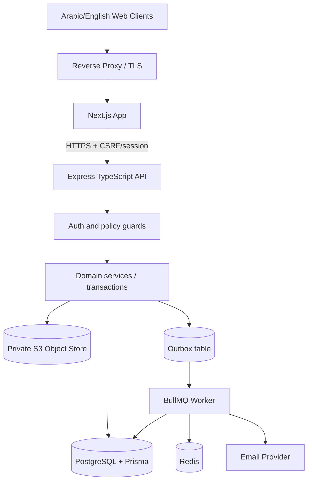

# 08 — Architecture, Infrastructure, Reliability

## Suggested deployment architecture


## Bounded modules
- `platform`: tenants status, approvals, usage aggregations.
- `identity`: platform vs agency staff vs customer sessions, invites, email verification, grants.
- `catalog`: platform templates, agency services, pricing, publishing.
- `requesting`: guest request, verification, lifecycle, patient association.
- `commercial`: quote versions, revisions, acceptance.
- `patients`: operational patient records, authorization, duplicate candidates, attachments.
- `caregivers`: qualifications, verified authorizations, weekly availability and exceptions.
- `care-plans`: versioned instructions, recurring templates and generation.
- `scheduling`: candidate query/ranking, conflict engine, direct assignment, change requests.
- `visits`: execution, tasks, completion, review and corrections.
- `notifications`: event/policies, in-app and email jobs.
- `reports`: tenant-local operational aggregates.
- `audit`: append-only events and reason tracking.

Use a **modular monolith** API initially: one deployable Express server with internal module boundaries, not premature microservices. Separate worker process only for asynchronous tasks.

## Tech stack defaults
- TypeScript strict mode, Node LTS pinned in repo and CI (verify version when starting implementation).
- Next.js App Router + accessible component library (shadcn/ui), Tailwind CSS, bilingual i18n structured namespaces.
- Express TypeScript, Zod schemas, OpenAPI generation, shared typed contracts.
- PostgreSQL + Prisma migrations; Redis + BullMQ worker; SMTP/API email adapter; private S3-compatible object storage; Playwright E2E and Vitest integration/unit tests.
- Local Docker Compose services; production deploy using Docker/Coolify with managed secrets and persistent data; no filesystem-only persistence for patient documents.
- Versions remain to be pinned and validated at Sprint 0; do not treat these as claims about current latest packages.

## Tenant routing
1. Portal request lands at `<slug>.<baseDomain>`; reverse proxy passes trusted host to app; app resolves slug against tenant registry and verifies portal ACTIVE/public flags.
2. Backend derives tenant from an approved trusted route/origin-to-tenant binding or a signed scoped session; validate server-side and reject mismatches. Do not accept arbitrary `Host` or `X-Forwarded-Host` unless reverse proxy strips/sets them and hosts allowlisted.
3. A user on `app.<baseDomain>/w/:slug` must have a session for that exact tenant; changing slug never changes privileges.
4. Shared storage and DB are logical multi-tenancy; no tenant query may omit scope. Private files use unique tenant prefix plus DB authorization.

## Reliable assignment algorithm (transaction boundary)
```ts
// Pseudocode, not copy-paste code. All assignment writers follow SAME locking order.
await prisma.$transaction(async (tx) => {
  const visit = await loadScopedVisitForUpdate(tx, tenantId, visitId);
  assertState(visit, ['PLANNED', 'SCHEDULED']);
  await lockCaregiverRowForUpdate(tx, tenantId, caregiverId);
  const policy = await loadTenantBufferAndAvailability(tx, tenantId);
  assertVerifiedQualificationsAndCoverage(tx, caregiverId, visit, policy);
  assertInWorkIntervalsAndNotOnLeave(tx, caregiverId, visit, policy);
  assertNoOverlappingAssignedVisitsWithBuffer(tx, caregiverId, visit, policy);
  await commitAssignmentAndVersion(tx, visit, caregiverId);
  await appendAuditAndOutbox(tx, ...);
}, { isolationLevel: 'ReadCommitted' });
```
- When reassigning from caregiver A to B and multiple rows require locks, acquire locks deterministically by UUID ascending to avoid deadlocks.
- Alternative implementation: `SERIALIZABLE` transaction with bounded retries for SQLSTATE `40001`. Even with serializable, validate domain rules and idempotency.
- Do **not** call email provider, object storage or external API while DB transaction is open.
- Bulk assignment supports independent per-visit atomic commits and returns successes/failures; no misleading all-or-nothing claim.

## Recurrence and timezones
- Agency IANA timezone is mandatory; persist original local date + clock and timezone with each plan version, and UTC start/end for each concrete visit.
- Generate inclusive local calendar dates selected by weekday, with cap 60 days; derive exact instants using timezone-aware date library; reject ambiguous or nonexistent DST times (or demand explicit disambiguation) instead of silent shift.
- `occurrenceKey` deterministic from planVersionId + local ISO date + ordinal for occurrence; `unique(tenantId,carePlanId,occurrenceKey)` blocks duplicates. On retries return existing results.
- Editing active plan requires preview of affected future visits; never rewrite past execution history or silently override already confirmed visits.

## Event/outbox and notification jobs
- State change and outbox event in same PostgreSQL transaction.
- Poller/worker dispatches due outbox events to BullMQ; worker checks tenant state + policy + minimal recipients, then sends in-app/email.
- Retry transient email failures with exponential backoff, capped attempts, failed queue and operator inspection; permanent failures flagged.
- Store dedupe key for `(eventId,recipient,channel)` so retries do not create duplicate business notifications; recognize exactly-once external email cannot be universally guaranteed.
- Avoid sending clinically sensitive content; events carry entity IDs, not patient notes.

## File handling
- Upload-intent API validates actor, resource linkage, allowed extensions/MIME/signature/size; storage key generated by server, private bucket only.
- Client uploads to short-lived signed URL with restricted size/type; finalize waits for antivirus/content checks where appropriate before making file downloadable. SVG/executable/HTML prohibited for sensitive attachment route unless separately safely handled.
- Download API authorizes tenant, patient/access grant, parent and classification, then issues short TTL signed read URL; do not store public file URL in DB.

## Observability
- Structured logs with correlationId and tenantId where safe; redact requester email, notes, tokens, addresses, auth headers; structured metric counts but no PHI tags.
- Health checks: liveness and readiness for API/web/worker; queue depth, failed jobs, error rate, DB pool saturation.
- Alerts for missing email jobs and unmatched critical events; backups and restore rehearsal.
- Audit access to sensitive records, document downloads, account permissions and changes; access logs controlled per retention policy.

## Failure behaviour
| Failure | Behaviour |
|---|---|
| Email provider down | Business transaction remains committed; outbox job retries; customer sees safe confirmation and resend flow |
| Redis down | Core DB operations may continue; outbox backlog; notify operations, don't lose events |
| Two simultaneous schedulers | One commits, one 409 with re-query guidance |
| App restart during visit | Server persists state and times; visit page reload reflects last committed status |
| Tenant suspended mid-session | Private API rejects, session invalidation; public portal does not accept new requests |
| Object scan fails | Document QUARANTINED; no download until verified; staff sees diagnostic status |
| Timezone changed | Future plan dates require preview/recalculation; committed historical visits keep original timezone snapshot |

## Production readiness (before actual sensitive data)
- TLS end-to-end, secrets management, database/object backups + verified recovery, rate limits, CSRF/session protection, access logs and audit review, incident plan, regulatory review, permissions tested, least privilege service accounts, encryption at rest and in transit.
- Do not advertise HIPAA/GDPR/Saudi PDPL or any regulatory compliance without a separate legal/security assessment of deployment context and contracts.
