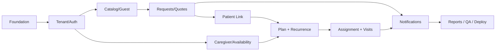

# 13 — Phased Delivery Plan and Engineering Work Orders

## Execution model
Build **vertical slices** with a deployable app after each slice, rather than completing every model and then every UI. Timebox includes test and error-path validation. Keep scope protected and record technical ADRs when implementation defaults change. Do not let agent invent new features or alter business states casually.

## Milestones
| Phase | Objective | Deliverable / gate |
|---|---|---|
| 0 — Foundation validation | Decide final runtime versions, web/API integration, tenant hostname scheme, auth cookie architecture, DB/Redis/object dev | Running skeleton, typed config, Docker Compose, health checks, CI, design tokens |
| 1 — Tenant + identity | Self-registration, pending/active/suspended, roles, staff invites, tenant-scoped sessions, Super Admin base | B tenant cannot access A data; invitation test; suspended tenant test |
| 2 — Catalog + portals | Templates import, agency services, publish, branded portal, bilingual/RTL layouts, guest service form + secure status link | Guest request E2E, unpublished service denied, no tracking reference auth bypass |
| 3 — Requests + commercial | Review queue and states, pricing snapshots, versioned quotes, verified acceptance/rejection, revision workflow | Quote E2E and version/race negative tests |
| 4 — Patients + caregiver setup | Patient operational profile, dedup suggestion, access grants, staff/caregiver qualifications, availability/leave | Grant and duplicate tests; eligibility API tested |
| 5 — Care plans + scheduling | Draft/version/approval, upfront 60-day recurrence, primary preference, candidate engine, travel buffer and transactional assignment | DST/recurrence tests; concurrent booking test |
| 6 — Visit execution + changes | Caregiver responsive portal, check-in/out, tasks/notes, correction/review; customer change approval/late policy | End-to-end visit; original appointment stable while change pending |
| 7 — Notifications + reporting + hardening | Notification matrix/policies/job retries, reports, files, audit, QA & deployment | Release gates in `12_TEST_PLAN.md` green |

## Dependency map


## Detailed sprint work orders
### Sprint 0 — Foundation
- **Owner-approved structure amendment:** use one Git repository containing
  self-contained `backend/` (Node.js/Express, Prisma, worker) and `frontend/`
  (Next.js) npm projects. See ADR-0007. Canonical Zod contracts live in
  `backend/src/contracts`; use per-project npm scripts.
- Workspace packages and lint/typecheck/test scripts; use shared status enums and zod schemas.
- Environment sample: DATABASE_URL, REDIS_URL, OBJECT_STORAGE_ENDPOINT, BUCKET, SESSION_SECRET, EMAIL_PROVIDER credentials, BASE_DOMAIN, proxy trusted hosts. Never commit real secrets.
- Setup Prisma schema migrations, DB seed synthetic fixture, outbox stub, worker stub and structured safe logger.
- App shell with `ar`/`en` routing and IBM Plex fonts, palette; visual placeholders clearly marked.
- **Exit:** local Docker up, web/API/worker connect; `npm test`, lint, typecheck,
  and build pass in each project. Downloads over ~50 MB are owner-run.

### Sprint 1 — Control plane and auth
- Tenant creation/status, owner verification, operator activation/suspend.
- Staff/customer auth realms and invites, session guard, CSRF, tenant host resolver, permission service.
- Add wrong-tenant tests for all new routes; build Super Admin tenant list.
- **Exit:** E01 and I01/I05/I06/I15 pass.

### Sprint 2 — Catalog and guest intake
- Platform service templates, agency-specific service clone/custom, publish/unpublish.
- Agency logo/primary brand settings, service list/detail, guest request form, verified request link.
- Locale-aware form validation, guest spam/rate limit; queue states and email receipt.
- **Exit:** E02 works in AR and EN; guest no account requirement met.

### Sprint 3 — Commercial journey
- Fixed pricing snapshot and price agreement acknowledgement; quote draft/send/expiry/version/revision.
- Verified customer quote actions, coordinator request decision conditions, outbox notification.
- Ensure no card-charge or invoice flows creep into scope.
- **Exit:** E03 and I10/I11 pass; domain state test suite green.

### Sprint 4 — People and access
- Patient create/link with same-tenant duplicate suggestions, multiple-authorized-patients grants.
- Caregiver qualification workflow (document + verified status), service authorization, regular availability and dated exceptions.
- Private file upload + download basic controls.
- **Exit:** F05/F06, I12/I16 pass and PHI doesn't leak in API projections.

### Sprint 5 — Care plans and matching
- Versioned plan, clinic-qualified approval capability, recurrence generator/upfront proposals.
- Candidate matching with primary preference; locked assignment and bulk partial outcomes; buffer and leave impact scanner.
- **Exit:** concurrency I08, recurrence I09 and DST tests pass.

### Sprint 6 — Visits and customer changes
- Mobile caregiver tasks, server timestamps, notes, completion, post-completion review/correction.
- Customer change-request policy config, late classification, coordinator approve/decline, timezone and conflict rechecks.
- **Exit:** E06/E07 and I13/I17 pass.

### Sprint 7 — Operational quality and launch prep
- In-app/email notifications with tenant policy, outbox/retry, templates, reminders, reports, audit screens and safe summaries.
- Accessibility and locale QA; performance budgets; Docker/Coolify deployment with monitoring and backup/restore rehearsal.
- **Exit:** all release gates green before describing as deployable pilot; real clinical data still requires separate review.

## Every sprint's definition of done
- Domain invariants and error cases fully implemented and covered by tests; correct status history/audit and outbox on state changes.
- Tenant scoped DB queries; `authorize()` checked at endpoint and domain resource boundary; synthetic seed no real PHI.
- API schema/contract updated; UI loading/error/empty/success states and Arabic/English translations present.
- Typecheck/lint/test/build pass; responsive design reviewed; progress notes and ADRs updated.
- Code review notes include security assumptions, risks, and what was intentionally deferred.

## Scope protection / tradeoff order
If behind schedule, cut nonessential customization and reporting visuals before essential patient grants, document security, conflict control, guest verification, or reliable reminders. Allow a narrower working vertical release rather than a deceptively complete but unsafe product. Defer custom domains, advanced graphs, exports, real-time chat, AI, payment processing and mobile apps.

## Estimate
Earlier 12–16 working days from Waslix comparison is a **stretch estimate**; accepted scope is broader than a CRUD MVP. No schedule guarantees. Re-estimate after Sprint 0 spikes (tenant auth, scheduling transaction, email token) and track actual work; use release gate criteria rather than elapsed days as completion proof.

## Next work request for an AI implementation agent
```text
Read docs/README.md and docs/01_PRODUCT_AND_DECISIONS.md through docs/13_IMPLEMENTATION_PLAN.md plus AGENTS.md. Treat D01–D23 as locked. Begin only Sprint 0: repository scaffold, validated stack versions, typed shared contracts, local Docker Compose dependencies, safe session/tenant interface, brand tokens and Arabic/English app shell. Produce an implementation plan and risks, then implement Sprint 0 completely. Do not implement later sprint features, fabricate compliance claims, generate real patient fixtures, or simplify tenant authorization. Run lint, typecheck, tests and builds; report exact commands/results and any deviations as ADRs.
```
